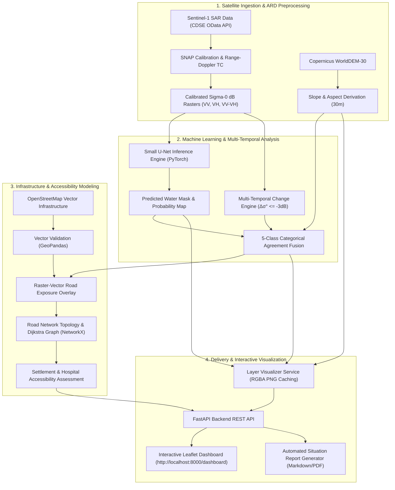

# SARA — Satellite-Assisted Rescue & Assessment

**An AI-Powered Multimodal Remote Sensing Platform for Emergency Flood Inundation Mapping, Multi-Temporal SAR Change Detection, and Post-Disaster Infrastructure Accessibility Assessment.**

[](https://www.python.org/)
[](https://fastapi.tiangolo.com/)
[](https://pytorch.org/)
[](https://leafletjs.com/)
[](LICENSE)
[](tests/)

---

> [!IMPORTANT]
> **Scientific Integrity & Attribution Notice**
> * **Contains modified Copernicus Sentinel data 2026.**
> * **Produced using Copernicus WorldDEM-30 © DLR e.V. 2010–2014 and © Airbus Defence and Space GmbH 2014–2018 provided under COPERNICUS by the European Union and ESA; all rights reserved.**
> * **© OpenStreetMap contributors.**
> * **Exploratory Change Candidates:** All generated flood extents, multi-temporal change masks, and agreement layers represent preliminary candidate classifications. They do **NOT** constitute verified flood boundaries or confirmed standing water.
> * **Suspected Shadow Candidates:** Excluded steep-slope predictions ($>15^\circ$) are classified as *suspected high-slope shadow candidates* based on DEM slope heuristics; DEM slope alone does not confirm the presence of radar shadow.
> * **No Life-Safety Claims:** Model outputs must **NOT** be used as sole proof of flooding, damage, road closures, or safety status without ground confirmation.

---

## 1. Project Overview & Problem Statement

### 1.1 The Challenge
During severe meteorological events, such as monsoon-triggered flooding and landslide dam outburst floods (GLOFs) in high-relief environments like the Nepal Himalayas, cloud cover frequently blinds optical Earth observation satellites (e.g., Sentinel-2, Landsat). Synthetic Aperture Radar (SAR) on board Copernicus Sentinel-1 provides all-weather, day-and-night microwave imaging capable of penetrating clouds and precipitation.

However, operational SAR flood mapping in complex mountainous terrain faces severe physical challenges:
1. **Specular Water vs. Radar Shadow Equifinality:** Calm surface water reflects radar pulses away from the sensor (specular reflection), resulting in very low backscatter intensity. Steep mountain back-slopes facing away from the radar look direction receive zero illumination (geometric radar shadow), producing an identical low-backscatter signal that causes severe false-positive flood predictions.
2. **Single-Scene Ambiguity:** Static single-scene segmentation cannot distinguish perennial water bodies (rivers, lakes) from transient disaster inundation.
3. **Infrastructure Isolation:** Standard satellite flood maps delineate water pixels but fail to evaluate whether critical road networks, settlements, and healthcare facilities are functionally isolated.

### 1.2 The SARA Solution
SARA (Satellite-Assisted Rescue & Assessment) is an end-to-end, modular geospatial intelligence system that bridges deep learning SAR water segmentation, physics-grounded multi-temporal change detection, topographic slope disambiguation, and topological graph-based road accessibility modeling.

---

## 2. Key Objectives & Target Users

### Objectives
* **Automated SAR Ingestion & Preprocessing:** Standardized pipeline for Sentinel-1 GRD dual-pol (VV/VH) calibrated sigma-nought ($\sigma^0$) backscatter in decibels.
* **Deep Learning Water Segmentation:** High-speed windowed inference using a lightweight Small U-Net (1.93M parameters) consuming a 3-channel input specification: `[VV_dB, VH_dB, VV_dB - VH_dB]`.
* **Multi-Temporal Change Fusion:** Logarithmic backscatter decrease detection ($\Delta \sigma^0 \le -3.0\text{ dB}$) comparing pre-event and post-event co-registered orbits.
* **Terrain-Aware Topographic Filtering:** Copernicus WorldDEM-30 slope stratification to isolate suspected high-slope radar shadows ($>15^\circ$) from flat lowland inundation.
* **5-Class Categorical Agreement Layer:** Disambiguates scene pixels into Dry Land, Persistent Water, Backscatter Change Only, Agreed Inundation Candidates, and Suspected High-Slope Shadow Candidates.
* **Post-Disaster Accessibility Analytics:** NetworkX Dijkstra shortest-path topological graph analysis to identify isolated settlements and cut-off healthcare facilities.
* **Interactive Web Dashboard:** High-performance Leaflet UI with live opacity blending, layer toggles, 5-class color legends, and prominent scientific safeguards.

### Target Users
* **Disaster Response & Emergency Management Agencies:** Rapid preliminary situational assessment and priority search-and-rescue routing.
* **Hydrological & Earth Science Researchers:** Reproducible benchmark evaluation of multimodal SAR-optical-DEM fusion.
* **Municipal Planners & Humanitarian NGOs:** Evidence-grounded post-disaster rehabilitation planning.

---

## 3. System Architecture & Workflow



---

## 4. Technology Stack

| Layer | Technology | Version | Purpose |
| :--- | :--- | :--- | :--- |
| **Language** | Python | `3.13.5` | Core runtime and backend execution |
| **API Framework** | FastAPI / Uvicorn | `0.115+` / `0.34+` | Asynchronous REST API, static asset and tile streaming |
| **Deep Learning** | PyTorch / Torchvision | `2.6.0+cu124` | Small U-Net model execution (FP16 AMP / CPU fallback) |
| **Raster Processing** | Rasterio / GDAL | `1.4+` | Windowed GeoTIFF I/O, CRS reprojection, affine transforms |
| **Vector Processing** | GeoPandas / Shapely / PyProj | `1.0+` | Vector geometry validation, spatial overlays, buffering |
| **Network Graph** | NetworkX | `3.4+` | Road network topology, Dijkstra shortest-path reachability |
| **Imaging & Overlays** | Pillow (PIL) / NumPy / SciPy | `11.0+` / `2.2+` | RGBA PNG overlay generation, palette mapping, array math |
| **Frontend Mapping** | Leaflet.js | `1.9.4` | Interactive web map, image overlays, live opacity blending |
| **Testing** | Pytest / AnyIO | `9.1+` | Automated unit, regression, and integration test suite |

---

## 5. Data Sources & Attributions

* **Sentinel-1 SAR Satellite Imagery:** European Space Agency (ESA) Copernicus Data Space Ecosystem (CDSE).
  * *Attribution:* *"Contains modified Copernicus Sentinel data (2024–2026)."*
* **Digital Elevation Model (DEM):** Copernicus WorldDEM-30 (30m Global DEM).
  * *Attribution:* *"Produced using Copernicus WorldDEM-30 © DLR e.V. 2010–2014 and © Airbus Defence and Space GmbH 2014–2018 provided under COPERNICUS by the European Union and ESA; all rights reserved."*
* **Infrastructure Data:** OpenStreetMap (OSM) vector features (Roads, Buildings, Healthcare Facilities, Settlements).
  * *Attribution:* *"© OpenStreetMap contributors."*
* **Benchmark Training Data:** Sen1Floods11 & KuroSiwo public flood segmentation datasets.
* **Strict EMSR927 Data Isolation:** Copernicus Emergency Management Service EMSR927 activation data is strictly quarantined in `validation/` and was **never** used for model training, threshold tuning, or operational prediction.

---

## 6. Project Directory Structure

```
Multimodal AI/sara/
├── backend/                        # FastAPI application & microservices
│   ├── main.py                     # API routing, endpoints & Leaflet dashboard UI
│   ├── config.py                   # Global system configuration & environment settings
│   └── services/                   # Modular service layer
│       ├── layer_visualizer.py     # Memory-bounded RGBA overlay rendering & caching
│       ├── unet_segmentation_service.py # Small U-Net windowed inference service
│       ├── dem_service.py          # DEM loading, clipping, and elevation analysis
│       ├── osm_infrastructure.py   # OSM vector data acquisition & parsing
│       ├── sentinel1_catalog.py    # CDSE OData / STAC catalogue discovery
│       ├── scene_compatibility.py  # Orbit geometry & repeat cycle validation
│       ├── download_planner.py     # Satellite download planner & budget limits
│       ├── download_service.py     # Resumable download manager with safeguards
│       └── situation_report.py     # Automated situation report generator
├── geospatial/                     # Core remote sensing & GIS processing modules
│   ├── aoi.py                      # Area of Interest geometry container & validation
│   ├── sar_preprocessing.py        # SNAP Processor Adapter & ARD specification
│   ├── snap_graph.py               # SNAP XML GPF processing graph builder
│   ├── unet_sar_preprocessor.py    # 3-channel SAR radiometric conversion [VV, VH, VV-VH]
│   ├── change_detection.py         # Multi-temporal logarithmic backscatter change engine
│   ├── terrain_analysis.py         # 30m slope/aspect gradient derivation & HAND
│   ├── flow_tracing.py             # D8 steepest-descent hydrological flow paths
│   ├── infrastructure.py           # Vector schema validation & topology container
│   ├── infrastructure_exposure.py  # Raster-vector flood exposure assessment
│   ├── road_network.py             # NetworkX road graph builder & topology
│   └── accessibility.py            # Dijkstra reachability & settlement isolation
├── ml/                             # Machine learning models & configuration
│   ├── model.py                    # SmallUNet PyTorch architecture (1.93M params)
│   ├── config.py                   # Model configuration loader & hyperparameters
│   └── rf_baseline.py              # Random Forest comparative baseline
├── config/                         # Configuration manifests
│   └── primary_segmentation_model.json # Small U-Net primary model contract
├── experiments/                    # Scientific audit reports & benchmarks
│   └── unet/                       # Small U-Net Nepal audit & integration reports
│       ├── best_model.pt           # Trained Small U-Net PyTorch model checkpoint
│       ├── nepal_end_to_end_integration_report.md
│       ├── nepal_final_validation_and_integration_audit.md
│       ├── nepal_multitemporal_change_analysis.md
│       └── nepal_dashboard_integration_report.md
├── docs/                           # Comprehensive technical documentation
│   ├── architecture.md             # Technical architecture & pipeline specification
│   ├── methodology_and_limitations.md # Scientific principles & limitations guide
│   ├── demo_script.md              # 5-7 minute step-by-step presentation script
│   ├── project_presentation_outline.md # 10-slide PowerPoint / slide deck outline
│   └── final_project_readiness_report.md # Final deployment readiness report
├── data/                           # Data storage (git-ignored rasters)
│   ├── raw/                        # Raw Sentinel-1 SAFE archives / Sen1Floods11
│   ├── processed/                  # Calibrated Sigma0, DEM, and Slope GeoTIFFs
│   ├── cache/                      # Fast catalogue and vector caches
│   └── output/                     # Model predictions, overlays, and situation reports
├── scripts/                        # Automation & preflight utility scripts
├── tests/                          # Automated unit, integration, and API test suite (121 tests)
├── requirements-core.txt           # Core FastAPI, Pydantic, HTTPX dependencies
├── requirements-geo.txt            # Geospatial Rasterio, GeoPandas, Shapely dependencies
└── requirements-ml.txt             # PyTorch, Torchvision, Scikit-learn dependencies
```

---

## 7. Environment Setup for Windows

### 7.1 Prerequisites
* **Operating System:** Windows 10 / 11 (64-bit)
* **Python Runtime:** Python `3.13.5` (or 3.10–3.13)
* **Hardware:** Minimum 8 GB RAM (16 GB recommended), NVIDIA GPU with CUDA 12.4 optional (CPU inference fully supported).
* **Optional External Tool:** [ESA SNAP 10.0+](https://step.esa.int/main/download/snap-download/) (only required if processing raw `.SAFE` archives from scratch using `gpt`).

### 7.2 Installation Steps

1. **Clone or Open Project Repository:**
   ```powershell
   cd "C:\Users\chara\OneDrive\Documents\Multimodal AI\sara"
   ```

2. **Activate the Virtual Environment:**
   ```powershell
   .\.venv\Scripts\Activate.ps1
   ```
   *If running directly with the virtual Python interpreter:*
   ```powershell
   .\.venv\Scripts\python.exe --version
   ```

3. **Install Dependencies (if setting up a new environment):**
   ```powershell
   .\.venv\Scripts\python.exe -m pip install --upgrade pip
   .\.venv\Scripts\python.exe -m pip install -r requirements-core.txt
   .\.venv\Scripts\python.exe -m pip install -r requirements-geo.txt
   .\.venv\Scripts\python.exe -m pip install -r requirements-ml.txt
   ```

---

## 8. Launching the Application

### 8.1 Start the FastAPI Backend Server
Run the following command from the project root:

```powershell
.\.venv\Scripts\uvicorn.exe backend.main:app --host 0.0.0.0 --port 8000 --reload
```

*Expected Terminal Output:*
```
INFO:     Uvicorn running on http://0.0.0.0:8000 (Press CTRL+C to quit)
INFO:     Started reloader process [...]
INFO:     Started server process [...]
INFO:     Waiting for application startup.
INFO:     Application startup complete.
```

### 8.2 Access the Applications
* **Interactive Leaflet Web Dashboard:** Open [`http://localhost:8000/dashboard`](http://localhost:8000/dashboard)
* **Interactive Swagger REST API Documentation:** Open [`http://localhost:8000/docs`](http://localhost:8000/docs)
* **Alternative Redoc API Documentation:** Open [`http://localhost:8000/redoc`](http://localhost:8000/redoc)

---

## 9. Running the Automated Test Suite
 
SARA includes a comprehensive test suite covering unit operations, API contracts, geospatial alignment, nodata handling, raster decimation, settlement accessibility, and model inference:
 
```powershell
# Run the complete test suite (166 automated tests)
.\.venv\Scripts\python.exe -m pytest tests/ -v
```
 
*Expected Result:* **166 passed, 0 failed in ~68s.**

---

## 10. Dashboard Features & Interactive Map Layers

When opening `http://localhost:8000/dashboard`, the map automatically loads the Nepal Himalayan AOI (`[28.5578, 85.3664]`):

```
+------------------------------------------------------------------------------------+
| SARA -- Flood Mapping & Accessibility Dashboard              [Nepal Analysis Active] |
+------------------------------------+-----------------------------------------------+
| 1. Active Scene & AOI Overview    | [Map View: Nepal Himalayan AOI]               |
|    Sentinel-1D (12-day revisit)    |                                               |
|    [Fit View to Nepal Scene]       |   [ Delineated River Corridors (Blue) ]       |
|                                    |   [ Floodplain Inundation Candidates (Cyan) ] |
| 2. Small U-Net Segmentation        |   [ Mountain Ridge Shadows (Orange) ]         |
|    [Run Small U-Net Inference]     |   [ OpenStreetMap Base Layer ]                |
|                                    |                                               |
| 3. Map Layer Controls & Opacity    |                                               |
|    [X] Multi-Temporal Agreement    |                                               |
|    [X] Baseline Model Prediction   |                                               |
|    [ ] Water Probability Heatmap   |                                               |
|    [ ] Terrain Slope (Copernicus)  |                                               |
|    [X] Target AOI Boundary         |                                               |
|                                    |                                               |
| 4. 5-Class Legend & Disclaimers    |                                               |
+------------------------------------+-----------------------------------------------+
```

### The 5-Class Multi-Temporal Agreement Framework

| Class Code | Category Name | Legend Color | Meaning & Physical Interpretation |
| :---: | :--- | :---: | :--- |
| **Class 0** | **Dry Land** | Transparent | No water predicted and stable backscatter ($\Delta \sigma^0 > -3\text{ dB}$). |
| **Class 1** | **Persistent Water Candidate** | Blue (`#1d4ed8`) | Water predicted on slope $\le 15^\circ$ with stable backscatter ($\Delta \sigma^0 > -3\text{ dB}$). Pre-existing perennial river networks and lakes. |
| **Class 2** | **Backscatter Change Only** | Yellow (`#eab308`) | Backscatter reduction $\le -3\text{ dB}$, but U-Net did not predict open water. Soil moisture saturation or agricultural changes. |
| **Class 3** | **Agreed Inundation Candidate** | Cyan (`#06b6d4`) | High-confidence candidate: U-Net water $\ge 0.50$ **AND** $\Delta \sigma^0 \le -3\text{ dB}$ **AND** $\text{Slope} \le 15^\circ$. |
| **Class 4** | **Suspected High-Slope Shadow Candidate** | Orange (`#ea580c`) | U-Net water predicted on steep mountain slopes ($> 15^\circ$). Suspected geometric radar-shadow false positives. |

---

## 11. Troubleshooting & FAQs

### Q1: PowerShell execution policy blocks `.venv\Scripts\Activate.ps1`
* **Solution:** Run PowerShell as Administrator and execute `Set-ExecutionPolicy -ExecutionPolicy RemoteSigned -Scope CurrentUser`, or invoke Python directly via `.\.venv\Scripts\python.exe`.

### Q2: Port 8000 is already in use
* **Solution:** Specify an alternative port when launching:
  ```powershell
  .\.venv\Scripts\uvicorn.exe backend.main:app --port 8080 --reload
  ```

### Q3: How are large satellite rasters rendered without crashing the browser?
* **Solution:** `LayerVisualizerService` uses windowed overview downsampling ($8,018 \times 5,379$ PNG, $3.93\text{ MB}$) and on-disk persistent caching. Peak RAM usage remains below $150\text{ MB}$, and cached responses load in $< 2\text{ ms}$.

---

## 12. Scientific Limitations & Future Roadmap

1. **Independent Validation Data:** No ground-truth flood masks currently exist for the full Nepal scene. Metrics represent relative overlap and physical exclusion rather than ground-truth accuracy.
2. **Local Incidence Angle (PLIA) Integration:** Future work will integrate direct sensor line-of-sight ray tracing (Projected Local Incidence Angle) to replace slope heuristics with exact geometric shadow masks.
3. **Multi-Temporal Baseline Stacking:** Transitioning from a single pre-event image to a multi-year seasonal median stack ($\mu_{\sigma^0}, \sigma_{\sigma^0}$) to compute statistical $Z$-score anomalies.
4. **Hydrologic Conditioning via HAND:** Integrating Height Above Nearest Drainage (HAND) to enforce drainage basin connectivity.

---

## 13. Documentation Index

For in-depth technical documentation, refer to the [`docs/`](docs/) directory:
* [`docs/architecture.md`](docs/architecture.md): Complete technical architecture, component breakdown, and source references.
* [`docs/methodology_and_limitations.md`](docs/methodology_and_limitations.md): Scientific guide on SAR physics, change detection, and validation requirements.
* [`docs/demo_script.md`](docs/demo_script.md): Step-by-step 5–7 minute live presentation and demonstration script.
* [`docs/project_presentation_outline.md`](docs/project_presentation_outline.md): 10-slide presentation deck outline with speaker notes.
* [`docs/final_project_readiness_report.md`](docs/final_project_readiness_report.md): Final deployment and portfolio readiness review.

---

## 14. License

This project is licensed under the MIT License — see the [LICENSE](LICENSE) file for details.
