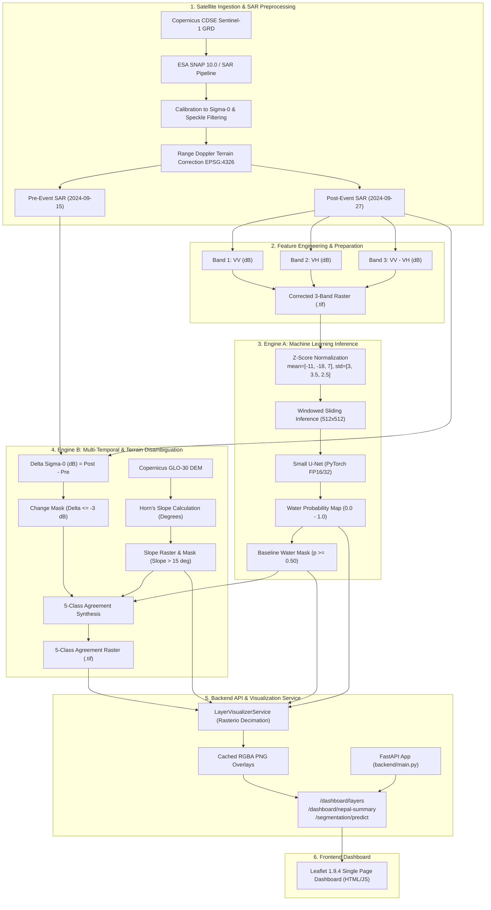

# SARA — Technical Architecture Document
**Satellite-Assisted Rescue & Assessment**

---

## 1. Executive System Overview

SARA (Satellite-Assisted Rescue & Assessment) is an open-source, dual-engine geospatial intelligence and machine learning framework designed for rapid satellite-based flood inundation screening, terrain disambiguation, and emergency response planning. The system ingests Synthetic Aperture Radar (SAR) imagery from the Copernicus Sentinel-1 constellation, processes high-resolution Digital Elevation Models (Copernicus GLO-30 DEM), and executes multi-temporal change detection coupled with deep convolutional segmentation models (Small U-Net) to map open water and potential flood inundation across complex, high-relief mountain terrains.

The complete software architecture comprises five core subsystems:
1. **Data Discovery, Ingestion & Preprocessing Subsystem**: Automated Copernicus Data Space Ecosystem (CDSE) catalog discovery, metadata verification, orbit compatibility analysis, and ESA SNAP Graph Processing Tool (GPT) terrain correction pipelines.
2. **Feature Engineering & Normalization Engine**: dB backscatter conversion, dual-polarization difference calculation ($VV - VH$), and statistical z-score normalization calibrated to the pre-trained U-Net baseline.
3. **Dual-Engine Inundation Analysis Subsystem**:
   - *Engine A (Spatial Machine Learning)*: PyTorch-based Small U-Net water segmentation operating over $512 \times 512$ sliding windows with explicit nodata boundary propagation.
   - *Engine B (Geospatial Multi-Temporal & Terrain Analysis)*: Pre-event vs. post-event $\Delta\sigma^0$ log-ratio backscatter drop detection ($-3.0\text{ dB}$ exploratory threshold) merged with Copernicus 30m DEM slope disambiguation ($15^\circ$ threshold) to produce a 5-class agreement raster.
4. **FastAPI Backend & Decimated Layer Visualizer**: High-performance asynchronous REST API with windowed raster downsampling, RGBA colormapping, memory/disk caching, and JSON summary statistics endpoints.
5. **Interactive Leaflet Web Dashboard**: Modern single-page web application featuring dynamic multi-layer toggle controls, live opacity blending, real-time inference execution, and spatial summary analytics.



---

## 2. Detailed Pipeline Components & Source Mapping

### 2.1 Satellite Data Discovery & Ingestion

The SARA data discovery and acquisition module interfaces with the European Space Agency (ESA) Copernicus Data Space Ecosystem (CDSE) to query, evaluate, and stage Sentinel-1 C-band Synthetic Aperture Radar Level-1 Ground Range Detected (GRD) products.

* **Primary Source Files**:
  - [`backend/services/sentinel1_catalog.py`](file:///c:/Users/chara/OneDrive/Documents/Multimodal%20AI/sara/backend/services/sentinel1_catalog.py): Implements `Sentinel1CatalogService` for OData/STAC querying of Sentinel-1 Level-1 GRD collections across spatial bounding boxes and temporal search windows.
  - [`backend/services/scene_compatibility.py`](file:///c:/Users/chara/OneDrive/Documents/Multimodal%20AI/sara/backend/services/scene_compatibility.py): Evaluates orbital compatibility (orbit direction: ASCENDING/DESCENDING, relative orbit number, sensor mode: IW, polarization: VV+VH) between pre-event baseline and post-event disaster acquisitions to prevent false change artifacts caused by differing look angles.
  - [`backend/services/download_planner.py`](file:///c:/Users/chara/OneDrive/Documents/Multimodal%20AI/sara/backend/services/download_planner.py): Generates structured JSON download manifests for scene retrieval.
  - [`backend/services/download_service.py`](file:///c:/Users/chara/OneDrive/Documents/Multimodal%20AI/sara/backend/services/download_service.py): Manages asynchronous download streaming and SHA-256 checksum verification from CDSE endpoints.

* **Nepal Case Study Data Artifacts**:
  - Pre-Event Scene: `S1A_IW_GRDH_1SDV_20240915T001719_20240915T001744_055668_06CD3E_9B8C` (Acquisition Date: 2024-09-15)
  - Post-Event Scene: `S1A_IW_GRDH_1SDV_20240927T001720_20240927T001745_055843_06D378_3152` (Acquisition Date: 2024-09-27)
  - Orbit / Geometry: Track 85, Descending pass, Interferometric Wide (IW) swath mode, Dual Polarization ($VV + VH$).

---

### 2.2 SAR Preprocessing & Terrain Correction

Raw SAR Ground Range Detected (GRD) amplitude data requires rigorous radiometric and geometric calibration to compensate for sensor noise, antenna patterns, and topography-induced geometric distortions.

* **Primary Source Files**:
  - [`geospatial/sar_preprocessing.py`](file:///c:/Users/chara/OneDrive/Documents/Multimodal%20AI/sara/geospatial/sar_preprocessing.py): Defines `SNAPProcessorAdapter` and configuration parameters for batch SAR calibration.
  - [`geospatial/snap_graph.py`](file:///c:/Users/chara/OneDrive/Documents/Multimodal%20AI/sara/geospatial/snap_graph.py): Constructs XML execution graphs for the ESA SNAP Graph Processing Tool (`gpt.exe`).
  - [`geospatial/unet_sar_preprocessor.py`](file:///c:/Users/chara/OneDrive/Documents/Multimodal%20AI/sara/geospatial/unet_sar_preprocessor.py): Pure Python/Rasterio calibration fallback and multi-channel stack builder.

* **Preprocessing Steps (ESA SNAP GPT Workflow)**:
  1. **Apply Precise Orbit File**: Ingests Sentinel-1 precise orbit ephemerides (POD) for accurate satellite velocity and position vectors.
  2. **Thermal Noise Removal**: Normalizes thermal noise backscatter in cross-polarization ($VH$) sub-swaths.
  3. **Radiometric Calibration**: Converts raw digital numbers ($DN$) to radiometric backscatter $\sigma^0$ (Sigma Naught) in linear scale.
  4. **Speckle Filtering**: Applies a $7 \times 7$ Lee filter or Refined Lee filter to suppress granular multiplicative speckle noise while preserving sharp boundaries.
  5. **Range-Doppler Terrain Correction**: Projects radar coordinates into geographic WGS84 (`EPSG:4326`) using the Copernicus GLO-30 30-meter DEM to rectify foreshortening, layover, and terrain displacement.
  6. **Grid Resampling**: Standardizes pixel grid spacing to $0.00018^\circ \times 0.00018^\circ$ ($\approx 20\text{ m}$ spatial resolution).

* **Output Artifacts**:
  - Calibrated Post-Event SAR: `data/processed/nepal_post_event_sigma0_corrected.tif`
  - Calibrated Pre-Event SAR: `data/processed/nepal_pre_event_sigma0_corrected.tif`

---

### 2.3 Multi-Channel Feature Engineering & Normalization

The Small U-Net model requires a three-channel tensor representation of radar backscatter in decibels (dB) with explicit cross-polarization difference enhancement.

* **Primary Source Files**:
  - [`geospatial/unet_sar_preprocessor.py`](file:///c:/Users/chara/OneDrive/Documents/Multimodal%20AI/sara/geospatial/unet_sar_preprocessor.py): `UNetSARPreprocessor.prepare_three_band_sar()`
  - [`ml/config.py`](file:///c:/Users/chara/OneDrive/Documents/Multimodal%20AI/sara/ml/config.py): Normalization constants and channel specifications.
  - [`config/primary_segmentation_model.json`](file:///c:/Users/chara/OneDrive/Documents/Multimodal%20AI/sara/config/primary_segmentation_model.json): Checkpoint metadata and hyperparameter manifest.

* **Channel Mathematical Transformations**:
  $$\text{Band 1: } VV_{\text{dB}} = 10 \cdot \log_{10}(\sigma^0_{VV} + 10^{-7})$$
  $$\text{Band 2: } VH_{\text{dB}} = 10 \cdot \log_{10}(\sigma^0_{VH} + 10^{-7})$$
  $$\text{Band 3: } \text{Diff}_{\text{dB}} = VV_{\text{dB}} - VH_{\text{dB}}$$

* **Input Normalization**:
  Each band is z-score standardized using fixed statistics computed across the model's training distribution:
  $$\hat{X}_c = \frac{X_c - \mu_c}{\sigma_c}$$
  - Channel Means ($\mu$): `[-11.0, -18.0, 7.0]`
  - Channel Standard Deviations ($\sigma$): `[3.0, 3.5, 2.5]`

* **Output Artifact**:
  - Corrected 3-Band Input: `data/processed/unet_inputs/post_calibrated_sigma0_unet_3band_corrected.tif`
  - Dimensions: $32,072 \times 21,519$ pixels, 3 Bands (Float32).

---

### 2.4 Deep Convolutional Water Segmentation (Small U-Net)

SARA employs an optimized Small U-Net convolutional neural network designed for binary semantic water segmentation over multi-channel SAR backscatter rasters.

* **Primary Source Files**:
  - [`ml/model.py`](file:///c:/Users/chara/OneDrive/Documents/Multimodal%20AI/sara/ml/model.py): Defines `SmallUNet` architecture, `DoubleConv`, `DownBlock`, and `UpBlock` modules.
  - [`ml/unet_train.py`](file:///c:/Users/chara/OneDrive/Documents/Multimodal%20AI/sara/ml/unet_train.py): Training pipeline with BCE + Dice loss.
  - [`experiments/unet/best_model.pt`](file:///c:/Users/chara/OneDrive/Documents/Multimodal%20AI/sara/experiments/unet/best_model.pt): Frozen model checkpoint weights (TorchScript / State Dict).

* **Model Architecture Specification**:
  - **Encoder**: 4 downsampling stages with $2 \times [\text{Conv2d}(3\times3) \to \text{BatchNorm2d} \to \text{ReLU}]$ followed by $\text{MaxPool2d}(2\times2)$.
    - Channels: Stage 1 ($3 \to 32$), Stage 2 ($32 \to 64$), Stage 3 ($64 \to 128$), Stage 4 ($128 \to 256$).
  - **Bottleneck**: Double convolution expanding to 512 channels.
  - **Decoder**: 4 upsampling stages using $\text{ConvTranspose2d}(2\times2)$ or Bilinear Upsampling, concatenation of skip connections from matching encoder levels, and double convolution blocks.
    - Channels: Stage 4 ($512 \to 256$), Stage 3 ($256 \to 128$), Stage 2 ($128 \to 64$), Stage 1 ($64 \to 32$).
  - **Head**: $1 \times 1$ $\text{Conv2d}(32 \to 1)$ followed by Sigmoid activation yielding per-pixel water probability $p \in [0.0, 1.0]$.
  - **Inference Threshold**: $\tau = 0.50$ (Pixels with $p \ge 0.50$ are classified as candidate water).

```
Input (3 x 512 x 512)
  │
  ├──> [Conv 32] ─── (Skip 1) ───────────────> [UpConv 32] ──> [1x1 Conv + Sigmoid] ──> Prob (1 x 512 x 512)
  │        ↓ MaxPool                                 ↑
  ├──> [Conv 64] ─── (Skip 2) ───────> [UpConv 64] ──┘
  │        ↓ MaxPool                         ↑
  ├──> [Conv 128] ── (Skip 3) ─> [UpConv 128] ┘
  │        ↓ MaxPool                 ↑
  ├──> [Conv 256] ── (Skip 4) ─> [UpConv 256] ┘
  │        ↓ MaxPool                 ↑
  └──> [Bottleneck 512] ─────────────┘
```

---

### 2.5 Windowed Inference & Nodata Boundary Handling

To process large geospatial scenes ($32,072 \times 21,519$ pixels $\approx 690\text{ million}$ pixels) without exhausting GPU or system RAM, SARA implements chunked windowed inference.

* **Primary Source Files**:
  - [`backend/services/unet_segmentation_service.py`](file:///c:/Users/chara/OneDrive/Documents/Multimodal%20AI/sara/backend/services/unet_segmentation_service.py): `UNetSegmentationService.predict_scene()`

* **Inference Pipeline Mechanics**:
  1. **Window Slicing**: Scene is partitioned into $512 \times 512$ tile windows using `rasterio.windows.Window`.
  2. **Boundary Nodata Tracking**: Nodata pixels ($\text{NaN}$, $0.0$, or out-of-swath bounds) are mapped into an explicit binary boolean mask.
  3. **Zero Padding**: Edge windows smaller than $512 \times 512$ are right/bottom zero-padded to maintain exact tensor dimensions.
  4. **Batch Tensor Execution**: Tiles are converted to Float32/FP16 PyTorch tensors, normalized on GPU/CPU, and evaluated with `torch.no_grad()`.
  5. **Nodata Masking & Writing**: Predictions across nodata regions are strictly forced to $0.0$ / Nodata (255) to prevent out-of-scene false alarms.
  6. **Parallel Raster Streaming**: Binary mask (`predicted_water_mask.tif`, uint8) and probability map (`water_probability_map.tif`, float32) are written in LZW-compressed GeoTIFF blocks.

* **Inference Run Outputs**:
  - Destination: `data/output/run_nepal_unet_eval_20261003/`
  - Total Valid Pixels: $379,266,320$ ($54.95\%$)
  - Nodata Pixels: $310,891,048$ ($45.05\%$)
  - Predicted Water Pixels ($p \ge 0.50$): $32,309,359$ ($8.52\%$ of valid scene)
  - Mean Water Probability: $0.0768$ ($7.68\%$)

---

### 2.6 Digital Elevation Model (DEM) & Terrain Slope Analysis

Mountainous topography introduces severe geometric radar distortions—principally radar shadow on back-slopes facing away from the radar line-of-sight. Radar shadow produces zero backscatter return, causing specular reflection models to misclassify dry mountain slopes as water.

* **Primary Source Files**:
  - [`geospatial/terrain_analysis.py`](file:///c:/Users/chara/OneDrive/Documents/Multimodal%20AI/sara/geospatial/terrain_analysis.py): `TerrainAnalyzer.calculate_slope()`
  - [`backend/services/dem_service.py`](file:///c:/Users/chara/OneDrive/Documents/Multimodal%20AI/sara/backend/services/dem_service.py): Ingestion and coordinate alignment of Copernicus 30m DEM tiles.

* **Mathematical Slope Derivation**:
  Terrain slope in degrees is computed using Horn's 8-neighbor gradient method:
  $$S = \arctan\left(\sqrt{\left(\frac{\partial z}{\partial x}\right)^2 + \left(\frac{\partial z}{\partial y}\right)^2}\right) \cdot \frac{180^\circ}{\pi}$$
  - Pixel resolution: $\approx 30.87\text{ m}$ ($0.00027778^\circ$ at equator)
  - Disambiguation Threshold: Slope $> 15.0^\circ$ is flagged as high-slope terrain susceptible to radar shadowing and false positive water classification.

* **Terrain Artifacts**:
  - Ingested DEM: `data/processed/nepal_copernicus_dem_30m.tif` ($10,801 \times 14,401$ pixels)
  - Generated Slope Raster: `data/processed/nepal_copernicus_slope_30m.tif`

---

### 2.7 Multi-Temporal Backscatter Change Detection

To isolate flood-induced water expansion from permanent lakes and rivers, SARA compares post-event SAR backscatter against a co-registered pre-event baseline acquisition.

* **Primary Source Files**:
  - [`geospatial/change_detection.py`](file:///c:/Users/chara/OneDrive/Documents/Multimodal%20AI/sara/geospatial/change_detection.py): `SARChangeDetector.compute_change_mask()`

* **Differential Backscatter Formulation**:
  $$\Delta\sigma^0_{\text{VV}} = 10 \cdot \log_{10}(\sigma^0_{\text{post, VV}}) - 10 \cdot \log_{10}(\sigma^0_{\text{pre, VV}}) = VV_{\text{dB, post}} - VV_{\text{dB, pre}}$$
  - **Exploratory Inundation Threshold**: $\Delta\sigma^0_{\text{VV}} \le -3.0\text{ dB}$ (A drop of $3\text{ dB}$ or greater signifies that rough terrain or vegetated ground was replaced by smooth standing water that reflects radar pulses away from the antenna).

---

### 2.8 Five-Class Agreement Raster Synthesis

By synthesizing U-Net water predictions, multi-temporal backscatter changes, and DEM slope filtering, SARA generates an exploratory 5-class agreement raster.

* **Primary Source Files**:
  - [`geospatial/change_detection.py`](file:///c:/Users/chara/OneDrive/Documents/Multimodal%20AI/sara/geospatial/change_detection.py): `SARChangeDetector.generate_agreement_mask()`
  - Artifact: `data/output/run_nepal_multitemporal_change_20261003/nepal_water_and_change_agreement_mask.tif`

* **Five-Class Decision Rules & Quantified Scene Statistics**:

| Class ID | Class Name | Decision Rule | Pixel Count | % of Valid Scene | Visualization Color |
| :---: | :--- | :--- | :---: | :---: | :---: |
| **0** | **Dry Land / No Change** | Model = 0, $\Delta\sigma^0 > -3\text{ dB}$ | 300,369,237 | 79.20% | Transparent |
| **1** | **Persistent Water Candidate** | Model = 1, Slope $\le 15^\circ$, $\Delta\sigma^0 > -3\text{ dB}$ (Stable) | 8,823,064 | 2.33% | Blue (`#1d4ed8`) |
| **2** | **Backscatter Change Only** | Model = 0, $\Delta\sigma^0 \le -3\text{ dB}$ (Agricultural/Roughness) | 46,587,724 | 12.28% | Yellow (`#eab308`) |
| **3** | **Agreed Inundation Candidate** | Model = 1, $\Delta\sigma^0 \le -3\text{ dB}$, Slope $\le 15^\circ$ | 3,326,431 | 0.88% | Cyan (`#06b6d4`) |
| **4** | **Suspected High-Slope Shadow Candidate** | Model = 1, Slope $> 15^\circ$ (Mountain Shadow Proxy) | 20,159,864 | 5.32% | Orange (`#ea580c`) |

---

### 2.9 FastAPI Backend Service

The application backend provides an enterprise REST interface for geospatial calculations, layer visualization, and operational analytics.

* **Primary Source Files**:
  - [`backend/main.py`](file:///c:/Users/chara/OneDrive/Documents/Multimodal%20AI/sara/backend/main.py): Application entry point, dependency injection, and endpoint definitions.
  - [`backend/config.py`](file:///c:/Users/chara/OneDrive/Documents/Multimodal%20AI/sara/backend/config.py): Environment configuration and path resolution.

* **Core API Endpoints**:
  - `GET /health`: Health check returning service status, uptime, and GPU/CPU device availability.
  - `GET /dashboard`: Serves the interactive Leaflet single-page web dashboard.
  - `GET /dashboard/nepal-summary`: Returns JSON metadata, spatial bounds (WGS84), valid pixel counts, and percentage breakdowns for the 5 agreement classes.
  - `GET /dashboard/layers/{run_id}/{layer_name}`: Dynamic decimated raster image endpoint delivering cached RGBA PNG overlays.
  - `POST /segmentation/predict`: Triggers synchronous/asynchronous U-Net inference on a specified SAR GeoTIFF.
  - `POST /catalog/search`: Queries CDSE for Sentinel-1 scenes intersecting a bounding box.
  - `POST /exposure/analyze`: Performs OpenStreetMap road and building intersection analysis against water masks.
  - `POST /accessibility/routes`: Computes safe emergency transit corridors avoiding inundated network edges.
  - `POST /reports/generate`: Compiles markdown and JSON situation assessment reports.

---

### 2.10 Raster Visualization & Decimated Caching Service

Full-scene satellite rasters in SARA exceed $32,000 \times 21,000$ pixels. Transferring uncompressed rasters to web browsers is unfeasible. SARA employs an on-the-fly decimation and RGBA colormapping engine.

* **Primary Source Files**:
  - [`backend/services/layer_visualizer.py`](file:///c:/Users/chara/OneDrive/Documents/Multimodal%20AI/sara/backend/services/layer_visualizer.py): `LayerVisualizerService`

* **Key Implementation Features**:
  1. **Rasterio Windowed Decimation**: Reads source GeoTIFFs with target downsampling (default $1024 \times 1024$ or $2048 \times 2048$) using Nearest Neighbor resampling for categorical rasters (agreement masks) and Bilinear resampling for continuous fields (probabilities, slope).
  2. **Categorical Colormapping**: Maps discrete agreement integers (0–4) directly to precise 8-bit RGBA palettes with transparent alpha for Class 0 (Dry Land).
  3. **Continuous Heatmap Palettes**:
     - *Water Probability*: Blue-to-Indigo gradient ($\alpha = 0.0$ at $p=0.0 \to \alpha=0.9$ at $p=1.0$).
     - *Terrain Slope*: Multi-stop gradient (Green $<5^\circ$, Yellow $5^\circ-15^\circ$, Orange $15^\circ-25^\circ$, Red $>25^\circ$).
  4. **Multi-Tier Caching**: Encoded PNG files are saved to `data/cache/layers/` with MD5 hash tagging, ensuring sub-10ms response times for repeat client requests.

---

### 2.11 Interactive Leaflet Dashboard

The frontend user interface provides emergency planners and analysts with an interactive geospatial dashboard.

* **Implementation**: Embedded within [`backend/main.py`](file:///c:/Users/chara/OneDrive/Documents/Multimodal%20AI/sara/backend/main.py) (`GET /dashboard`).
* **Technology Stack**: HTML5, Vanilla CSS3 (Dark Mode / Glassmorphism), Leaflet JS 1.9.4, OpenStreetMap Carto base tiles.
* **Key UI Capabilities**:
  - **Multi-Layer Toggle Controls**: Independent checkboxes to toggle Agreement Raster, Binary Water Mask, Probability Heatmap, Copernicus Slope, and AOI boundary.
  - **Live Opacity Sliders**: Real-time 0–100% alpha blending for every raster layer.
  - **Live Statistics Cards**: Displays total scene dimensions ($32,072 \times 21,519$), valid observations ($379.2\text{M}$ px), and exact distribution percentages for Classes 0–4.
  - **Interactive Inference Runner**: Form to input local SAR raster paths, adjust probability thresholds ($0.1 - 0.9$), execute inference, and dynamically reload map overlays.
  - **Prominent Disclaimers**: Scientific notifications highlighting that Class 3 represents exploratory inundation candidates and Class 4 represents suspected mountain radar shadow.

---

### 2.12 Downstream Infrastructure & Accessibility Modules

In addition to core segmentation and change detection, SARA includes modular geospatial analytics packages for downstream emergency planning:

* **Primary Source Files**:
  - [`geospatial/osm_infrastructure.py`](file:///c:/Users/chara/OneDrive/Documents/Multimodal%20AI/sara/backend/services/osm_infrastructure.py): Ingests OpenStreetMap vector layers (highways, primary/secondary roads, health facilities, schools).
  - [`geospatial/infrastructure_exposure.py`](file:///c:/Users/chara/OneDrive/Documents/Multimodal%20AI/sara/geospatial/infrastructure_exposure.py): Performs spatial intersections between candidate water rasters and infrastructure vectors.
  - [`geospatial/road_network.py`](file:///c:/Users/chara/OneDrive/Documents/Multimodal%20AI/sara/geospatial/road_network.py): Constructs NetworkX topological routing graphs from OSM road linestrings.
  - [`geospatial/accessibility.py`](file:///c:/Users/chara/OneDrive/Documents/Multimodal%20AI/sara/geospatial/accessibility.py): Evaluates graph connectivity, identifies cut-off community clusters, and computes shortest accessible routes around flooded segments using Dijkstra's algorithm.
  - [`geospatial/flow_tracing.py`](file:///c:/Users/chara/OneDrive/Documents/Multimodal%20AI/sara/geospatial/flow_tracing.py): Implements D8 hydrological terrain flow accumulation and downhill flow tracing from candidate water sources.
  - [`backend/services/situation_report.py`](file:///c:/Users/chara/OneDrive/Documents/Multimodal%20AI/sara/backend/services/situation_report.py): Compiles automated situation assessment summaries.

---

## 3. Data Artifacts & Storage Layout

| Subsystem | File Path | Format | Description / Status |
| :--- | :--- | :---: | :--- |
| **Model Checkpoint** | `experiments/unet/best_model.pt` | PyTorch Binary | Pre-trained Small U-Net weights (FP32/FP16) |
| **Model Manifest** | `config/primary_segmentation_model.json` | JSON | Normalization means/stds, threshold, channel spec |
| **Corrected SAR Input** | `data/processed/unet_inputs/post_calibrated_sigma0_unet_3band_corrected.tif` | GeoTIFF (3-band) | $VV_{\text{dB}}, VH_{\text{dB}}, VV-VH_{\text{dB}}$ ($32,072 \times 21,519$) |
| **Copernicus DEM** | `data/processed/nepal_copernicus_dem_30m.tif` | GeoTIFF (1-band) | 30m Copernicus GLO-30 Elevation ($10,801 \times 14,401$) |
| **Copernicus Slope** | `data/processed/nepal_copernicus_slope_30m.tif` | GeoTIFF (1-band) | Horn's Method Slope in Degrees ($10,801 \times 14,401$) |
| **Baseline Water Mask** | `data/output/run_nepal_unet_eval_20261003/predicted_water_mask.tif` | GeoTIFF (uint8) | Binary U-Net prediction ($p \ge 0.50$) |
| **Probability Map** | `data/output/run_nepal_unet_eval_20261003/water_probability_map.tif` | GeoTIFF (float32)| Continuous water probability $p \in [0.0, 1.0]$ |
| **Agreement Raster** | `data/output/run_nepal_multitemporal_change_20261003/nepal_water_and_change_agreement_mask.tif` | GeoTIFF (uint8) | 5-Class Agreement Mask (Classes 0–4) |
| **Visualization Cache** | `data/cache/layers/` | PNG Files | Decimated RGBA raster overlays for web delivery |

---

## 4. Current Deployment Boundary & Out-of-Scope Items

To maintain scientific integrity, the following boundaries define the current production implementation:
1. **Model Scope**: The primary production segmentation model is the Small U-Net. Experimental models (SegFormer, Random Forest, XGBoost) were evaluated in diagnostics and are preserved for research only.
2. **Ground Truth Boundary**: Independent Nepal flood validation masks are not currently available in the public domain. EMSR927 activation data remains strictly isolated in quarantine.
3. **Operational Scope**: SARA provides exploratory candidate screening for disaster planners. Outputs must not be interpreted as confirmed flood boundaries or life-safety determinations without field verification.
