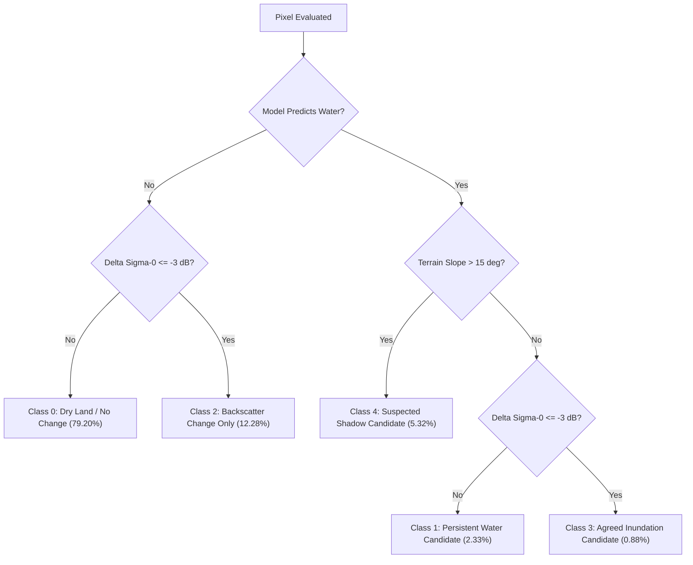

# SARA — Scientific Methodology & Limitations Guide
**Satellite-Assisted Rescue & Assessment**

---

## 1. Introduction & Physical Principles of SAR Water Detection

### 1.1 How Synthetic Aperture Radar (SAR) Senses the Earth's Surface
Unlike optical satellite sensors (such as Sentinel-2 or Landsat) that rely on reflected sunlight and are blocked by cloud cover, rain, and nighttime darkness, Synthetic Aperture Radar (SAR) is an active microwave imaging system. The Sentinel-1 satellite emits coherent C-band microwave pulses (wavelength $\lambda \approx 5.6\text{ cm}$) towards the Earth and measures the intensity and phase of the backscattered energy returned to the sensor.

The measured backscatter coefficient ($\sigma^0$, Sigma Naught, expressed in decibels $\text{dB}$) depends primarily on two surface characteristics:
1. **Surface Roughness**: The height variations of the surface relative to the microwave wavelength.
2. **Dielectric Constant**: The electrical permittivity of the material, which increases substantially with liquid water content.

```
       Radar Antenna                          Radar Antenna
           ▲   │                                  ▲   │
           │   │ Emitted Pulse                    │   │ Emitted Pulse
           │   ▼                                  │   ▼
     ┌─────────────┐                        ┌─────────────┐
     │ Smooth Open │ Specular Reflection    │ Rough Earth │ Diffuse Scattering
     │    Water    │ ───────────────►       │ / Vegetation│ ◄───▲───► (Strong Return)
     └─────────────┘ (No Energy Returns)    └─────────────┘
```

### 1.2 Specular Reflection vs. Diffuse Scattering
* **Smooth Water Surfaces (Specular Reflection)**: Calm open water acts like a mirror to microwave radiation. When the radar pulse hits the flat water surface at an oblique angle of incidence ($\approx 30^\circ - 45^\circ$), almost all the energy is reflected away from the satellite antenna into space. Consequently, very little energy returns to the sensor, causing open water to appear **dark** (very low backscatter, typically $\sigma^0_{VV} < -16\text{ dB}$ to $-24\text{ dB}$).
* **Rough Land, Vegetation, and Urban Structures (Diffuse Scattering)**: Rough soil, trees, and buildings scatter microwave energy in all directions, reflecting a significant portion directly back to the satellite. These surfaces appear **bright** in SAR imagery (typically $\sigma^0_{VV} > -12\text{ dB}$).

---

## 2. Multi-Temporal Backscatter Comparison

### 2.1 Why Dual-Date Observation is Crucial
A single post-disaster SAR image can identify dark, low-backscatter surfaces, but it cannot differentiate between:
- Permanent water bodies (such as existing rivers, natural lakes, and reservoirs).
- Newly flooded land (inundation of agricultural fields, roads, or inhabited plains).

To isolate event-driven flood inundation, SARA compares a **post-event SAR scene** (acquired on 2024-09-27 during the monsoon event) against a co-registered **pre-event SAR baseline** (acquired on 2024-09-15 prior to heavy rainfall).

### 2.2 The $-3.0\text{ dB}$ Exploratory Change Threshold
The backscatter difference is calculated in decibels for the co-polarized $VV$ band:
$$\Delta\sigma^0_{\text{VV}} = \sigma^0_{\text{post, VV}}(\text{dB}) - \sigma^0_{\text{pre, VV}}(\text{dB})$$

Because decibels are logarithmic ($10 \cdot \log_{10}(P_{\text{post}} / P_{\text{pre}})$):
- A change of $\Delta\sigma^0 = 0\text{ dB}$ indicates identical radar return between dates.
- A change of $\Delta\sigma^0 = -3.0\text{ dB}$ corresponds to a **50% reduction** in linear backscatter power ($10^{-0.3} \approx 0.501$).

When previously rough or vegetated terrain is inundated by floodwater, the specular reflection causes a rapid, sharp drop in backscatter ($\Delta\sigma^0 \le -3.0\text{ dB}$).

---

## 3. Topographic Challenges & Terrain Slope Disambiguation

### 3.1 The Radar Shadow Phenomenon in Mountainous Regions
In regions with steep relief—such as the Himalayan terrain of Nepal—side-looking radar geometry creates severe radiometric artifacts:
- **Radar Shadow**: Mountain slopes facing away from the satellite line-of-sight are completely occluded from radar illumination. No microwave energy reaches these areas, resulting in a recorded backscatter value near zero.
- **The Shadow-Water Confusion**: Because both open water and radar shadow produce near-zero backscatter, machine learning models and thresholding algorithms frequently misclassify steep dry mountain slopes as water bodies.

```
                  Satellite Orbit / Sensor
                         \
                          \ Look Angle (theta)
                           \
                            ▼
                         /\
                        /  \  <--- Radar Shadow (Zero return, dark)
     Illuminated Slope /    \      (Misclassified as water by naive models!)
                      /      \
```

### 3.2 Terrain Slope as a Disambiguation Filter
Liquid water seeks the lowest gravitational potential and cannot accumulate or form standing pools on steep mountain slopes. By ingesting the Copernicus GLO-30 Digital Elevation Model (30m resolution), SARA calculates topographic slope using Horn's method:
$$S = \arctan\left(\sqrt{\left(\frac{\partial z}{\partial x}\right)^2 + \left(\frac{\partial z}{\partial y}\right)^2}\right) \cdot \frac{180^\circ}{\pi}$$

* **Slope Threshold ($15.0^\circ$)**: Any pixel predicted as water on terrain with a slope $> 15^\circ$ is flagged as a **Suspected High-Slope Shadow Candidate (Class 4)** rather than genuine standing water.

### 3.3 Why Slope Alone Cannot Prove Radar Shadow
While a slope $> 15^\circ$ is an effective physical proxy to eliminate implausible water pooling, slope alone is not mathematical proof of radar shadow. True geometric shadow depends on:
1. Local surface orientation (aspect angle $\phi$) relative to the satellite flight path and range vector.
2. The local incidence angle ($\theta_i$) across the terrain profile.
3. Total topographic occlusion along the line-of-sight.

Consequently, Class 4 is strictly categorized as a **candidate proxy**, not a definitive physical shadow mask.

---

## 4. The Five-Class Agreement Raster Explained

SARA synthesizes the spatial machine learning predictions (Small U-Net), multi-temporal change detection ($\Delta\sigma^0$), and DEM slope filtering into a comprehensive 5-class agreement raster.



### 4.1 Detailed Class Definitions & Statistics (Nepal AOI)

| Class | Name | Scientific Interpretation | Observed Pixels | AOI Area (%) |
| :---: | :--- | :--- | :---: | :---: |
| **0** | **Dry Land / No Change** | Stable non-water terrain where backscatter remained consistent and no water was detected. | 300,369,237 | 79.20% |
| **1** | **Persistent Water Candidate** | Water predicted by U-Net on gentle terrain ($\le 15^\circ$) with stable backscatter ($\Delta\sigma^0 > -3\text{ dB}$). Represents permanent rivers, lakes, and reservoirs. | 8,823,064 | 2.33% |
| **2** | **Backscatter Change Only** | Significant backscatter drop ($\Delta\sigma^0 \le -3\text{ dB}$) where U-Net did not predict water. Caused by agricultural harvesting, soil moisture changes, or vegetation shifts. | 46,587,724 | 12.28% |
| **3** | **Agreed Inundation Candidate** | **High-confidence candidate flood zone**: U-Net water prediction confirmed by significant backscatter reduction ($\Delta\sigma^0 \le -3\text{ dB}$) on flat, poolable terrain ($\le 15^\circ$). | 3,326,431 | 0.88% |
| **4** | **Suspected High-Slope Shadow Candidate** | Water predicted on steep terrain ($> 15^\circ$). High likelihood of false positive water prediction caused by topographic radar shadow or layover. | 20,159,864 | 5.32% |

---

## 5. Potential Sources of False Positives & Confusion

Users and emergency responders must understand the physical edge cases that can induce classification errors:

### 5.1 Agricultural Harvesting & Soil Moisture
- When crops are harvested or fields are plowed between satellite passes, surface roughness decreases, creating a $-3\text{ dB}$ to $-6\text{ dB}$ backscatter drop that mimics standing water.
- High soil saturation from heavy antecedent rainfall lowers dielectric resistivity and alters backscatter, occasionally triggering Class 2 or Class 3 flags in non-flooded fields.

### 5.2 Smooth Non-Water Surfaces
- Airport runways, wide asphalt highways, and flat dry sand bars exhibit smooth surface textures that cause specular radar reflection, appearing identical to open water in single-date SAR imagery.

### 5.3 Wind-Ruffled Water & Vegetation Emergence
- Strong surface winds generate capillary waves on open floodwaters, increasing surface roughness and causing diffuse backscatter. This causes floodwaters to appear bright, resulting in false negatives (missed flood detection).
- Emergent vegetation protruding above floodwater causes double-bounce scattering (radar pulse bounces off water then tree trunk back to sensor), making flooded forests appear bright rather than dark.

---

## 6. Critical Operational Distinctions & Validation Boundaries

To maintain rigorous scientific standards, the SARA platform strictly enforces four analytical distinctions:

```
┌─────────────────────────────────────────────────────────────────────────────────┐
│                           LEVELS OF EVIDENCE IN SARA                            │
├──────────────────────────┬──────────────────────────────────────────────────────┤
│ A. Model Predictions     │ Raw probabilistic inferences produced by Small U-Net. │
├──────────────────────────┼──────────────────────────────────────────────────────┤
│ B. Change Observations   │ Physical backscatter differences (Delta Sigma-0).    │
├──────────────────────────┼──────────────────────────────────────────────────────┤
│ C. Candidate Inundation  │ Multi-source consensus (Class 3: Model + Change + DEM)│
├──────────────────────────┼──────────────────────────────────────────────────────┤
│ D. Verified Flood Extent │ Confirmed ground-truth requiring in-situ or optical  │
│                          │ reference validation (NOT CURRENTLY AVAILABLE).      │
└──────────────────────────┴──────────────────────────────────────────────────────┘
```

### 6.1 Status of Ground Truth & Accuracy Metrics
> [!IMPORTANT]
> **Independent Nepal ground-truth flood masks are not currently available.**
> In accordance with scientific audits, SARA does **NOT** report ungrounded precision, recall, F1-score, or IoU metrics for the Nepal event.
> The Copernicus Emergency Management Service (EMS) activation **EMSR927** data remains strictly isolated in quarantine and was not used for model training, tuning, or threshold calibration.

### 6.2 Operational Disclaimers
1. **No Life-Safety Reliance**: SARA outputs are exploratory decision-support screening tools. They must not be used as sole proof of structural damage, road closures, or life-safety determinations.
2. **Exploratory Thresholds**: The $-3.0\text{ dB}$ change threshold and $15.0^\circ$ slope threshold are heuristic screening benchmarks and have not been universally validated for all Himalayan soil types.
