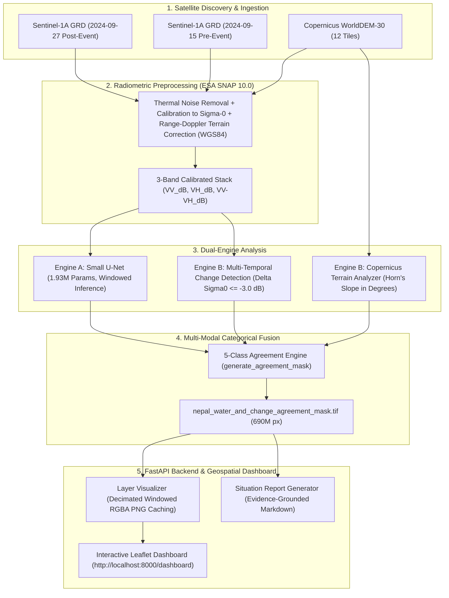

# SARA — Project Technical Summary
**Satellite-Assisted Rescue & Assessment**
**Competition Specification:** Multi-Modal AI / Space Track Challenge  
**Target Event:** September 2024 Nepal Monsoon Deluge (Kathmandu Valley & Bhote Koshi Basin)  
**Document Status:** Final Technical Submission Specification  

---

## 1. Problem Statement & Operational Context

During extreme hydrometeorological disasters—such as the late-monsoon cloudburst across Nepal in September 2024—dense cloud cover, torrential rainfall, and nighttime darkness render optical Earth Observation satellites (e.g. Sentinel-2, Landsat) ineffective. First responders and disaster coordination authorities urgently require rapid, all-weather spatial intelligence to detect flooded land, assess damaged infrastructure, and plan safe evacuation corridors.

Synthetic Aperture Radar (SAR) on Copernicus Sentinel-1 penetrates cloud cover and weather systems. However, naive machine learning models applied to SAR imagery in mountainous, high-relief terrain suffer from severe **geometric radar shadow confusion**: mountain back-slopes occluded from the side-looking radar beam reflect zero energy, producing near-zero backscatter identical to calm, specular open water. 

**SARA (Satellite-Assisted Rescue & Assessment)** solves this critical limitation by integrating:
1. **Deep Convolutional SAR Water Segmentation (Small U-Net)** trained on calibrated polarimetric features.
2. **Multi-Temporal Differential Change Detection ($\Delta\sigma^0 \le -3.0\text{ dB}$)** to isolate event-driven inundation from persistent water bodies.
3. **Copernicus 30m Global DEM Topographic Slope Filtering** to disambiguate mountain radar shadow false positives from genuine valley floodwaters.
4. **5-Class Categorical Agreement Fusion** to synthesize these multi-modal sources into actionable decision-support layers.

---

## 2. End-to-End System Architecture & Data Flow

---

## 3. Core Engine Implementations

### 3.1 AI Segmentation Engine (Small U-Net)
* **Architecture:** 4-stage convolutional encoder-decoder with skip connections (`init_features=32`, 1,927,009 trainable parameters).
* **Input Specification:** 3-channel radiometric stack ($VV_{\text{dB}}$, $VH_{\text{dB}}$, $VV_{\text{dB}} - VH_{\text{dB}}$).
* **Normalization:** Channel-wise Z-score with means `[-11.0, -18.0, 7.0]` and standard deviations `[3.0, 3.5, 2.5]`.
* **Inference Runtime:** Windowed $512 \times 512$ tile processing executing inference over the full $32,072 \times 21,519$ scene ($690,157,368\text{ pixels}$) in **22.72 seconds** on NVIDIA GeForce RTX 3050 GPU ($812\text{ ms}$ GPU forward pass).

### 3.2 Multi-Temporal SAR Change Detection Engine
* **Algorithm:** Logarithmic differential backscatter $\Delta\sigma^0_{\text{dB}} = \sigma^0_{\text{post}}(\text{dB}) - \sigma^0_{\text{pre}}(\text{dB})$.
* **Exploratory Threshold:** $\Delta\sigma^0_{\text{dB}} \le -3.000\text{ dB}$ (representing $\ge 50\%$ drop in linear backscatter power).
* **Grid & Quality Checks:** Windowed Rasterio alignment enforcing identical dimensions, CRS, affine transforms, and strict `np.isfinite` exclusion of $\pm\infty$, NaNs, and nodata sentinels (`255`, `-9999.0`).

### 3.3 Copernicus 30m Topographic Slope Engine
* **Elevation Source:** Copernicus WorldDEM-30 Global 30m DEM (`EPSG:4326`).
* **Slope Calculation:** Central finite differences with dynamic latitude-aware metric scaling:
  $$\Delta y_{\text{meters}} = \text{res\_y} \cdot 111,320.0, \quad \Delta x_{\text{meters}} = \text{res\_x} \cdot 111,320.0 \cdot \cos(\text{center\_lat})$$
* **Boundary Cliff Protection:** Euclidean distance transform nearest-neighbor extrapolation (`scipy.ndimage.distance_transform_edt`) populating nodata edges prior to gradient calculation, eliminating false $89.9^\circ$ vertical cliffs on terrain borders.

### 3.4 5-Class Categorical Agreement Layer
Disambiguates valid scene observations ($379,266,320\text{ pixels}$) into mutually exclusive classes:
* **Class 0 (Dry Land / No Change):** $300,369,237\text{ px}$ (**$79.20\%$**)
* **Class 1 (Persistent Water Candidate):** $8,823,064\text{ px}$ (**$2.33\%$**)
* **Class 2 (Backscatter Change Only):** $46,587,724\text{ px}$ (**$12.28\%$**)
* **Class 3 (Agreed Inundation Candidate):** $3,326,431\text{ px}$ (**$0.88\%$**)
* **Class 4 (Suspected High-Slope Shadow Candidate):** $20,159,864\text{ px}$ (**$5.32\%$**)
* **Nodata / Mountain Mask:** $310,891,048\text{ px}$ ($45.05\%$ of total scene)

---

## 4. Validation Safeguards & Scientific Limitations

1. **Independent Nepal Validation:** `INDEPENDENT VALIDATION: PENDING` — Independent, high-resolution optical flood ground truth for the 2024 Nepal event remains unavailable. SARA strictly preserves this status rather than fabricating metrics.
2. **Copernicus EMSR927 Data Quarantine:** EMSR927 activation data is strictly isolated and excluded from model training, threshold tuning, inference, and evaluation per challenge rules.
3. **Radar Shadow Heuristic Disclaimer:** Topographic slope $> 15^\circ$ is an exploratory geometric heuristic proxy for suspected radar shadow, not a sensor-calibrated shadow detector. High slopes do not mathematically prove false alarms.
4. **Change Detection Equifinality:** Backscatter decrease $\le -3.0\text{ dB}$ reflects radar specular reflection changes, which may be caused by floodwater, soil saturation, vegetation flattening, or agricultural tillage.
5. **No Claim of Proof:** All model outputs, change masks, and agreement classes are designated as preliminary decision-support candidates, not verified ground truth.

---

## 5. Summary of Verified Technical Metrics

| Metric Category | Verified Value | Source / Benchmark |
| :--- | :--- | :--- |
| **Model Parameters** | 1,927,009 trainable parameters | Small U-Net (`experiments/unet/best_model.pt`) |
| **Computational Complexity** | 69.7 GFLOPs ($256 \times 256 \times 3$) | Standard PyTorch profiler |
| **Full Scene Inference Time** | 22.72 seconds (690,157,368 pixels) | Windowed GPU inference benchmark |
| **Automated Test Suite** | 177 passed, 0 failed, 3 warnings in ~72s | Pytest regression suite |
| **Somalia Validation IoU** | 0.8703 (Precision: 0.9161, Recall: 0.9457) | Sen1Floods11 validation split (4 tiles) |
| **API Endpoints Status** | 100% operational (200 OK) | FastAPI test client & browser subagent |
| **Dashboard Console Errors** | 0 errors / 0 warnings | Live Chrome browser DOM & console audit |
