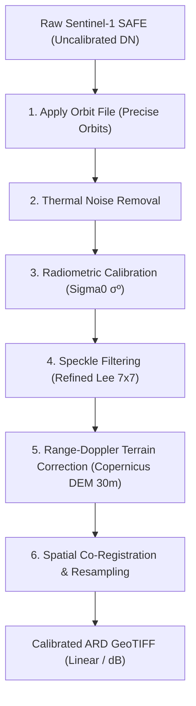

# SARA — Sentinel-1 SAR Preprocessing & Change Detection Engineering Guide

This document details the engineering specifications, mathematical formulas, software adapters, and limitations for converting Sentinel-1 SAR imagery into preliminary flood-change rasters.

---

## 📡 1. Catalogue Discovery vs. Product Download vs. Processing

- **Catalogue Discovery (Phase 2):** Queries metadata via CDSE OData/STAC APIs to identify scene acquisition dates, relative orbit numbers, orbit directions (`ASCENDING`/`DESCENDING`), and spatial coverage. Lightweight network operation; no rasters are downloaded.
- **Product Download:** Fetches compressed Sentinel-1 SAFE archive files (~1.5 GB to 2.5 GB per scene). Requires disk space budget checks prior to downloading.
- **SAR Preprocessing (Phase 3):** Converts uncalibrated SAFE Digital Numbers (DN) into Analysis-Ready Data (ARD) GeoTIFFs through orbit correction, noise removal, radiometric calibration, terrain correction, and co-registration.

---

## 🛠️ 2. Raw GRD Products vs. Analysis-Ready Data (ARD)

Raw Sentinel-1 Ground Range Detected (GRD) products contain uncalibrated raw radar intensity values in slant-range or ground-range projection. They are **not** analysis-ready until the following 6-step pipeline is executed:

### Why Relative Orbit Matching is Not Sufficient for Pixel Alignment:
Even when two scenes share the exact same relative orbit number, slight satellite trajectory shifts, atmospheric refractivity changes, and digital elevation model (DEM) projection variances cause multi-pixel spatial offsets. **DEM-assisted co-registration** or spatial resampling is strictly required prior to pixel-by-pixel change detection.

---

## 📐 3. Radiometric Backscatter Units & Change Mathematics

SAR backscatter intensity can be represented in **linear power** ($\sigma^0$) or **decibels** ($\text{dB}$):

$$\sigma^0_{\text{dB}} = 10 \cdot \log_{10}(\sigma^0_{\text{linear}})$$

### Logarithmic Change Ratio Formula:
Water surfaces act as specular (mirror-like) reflectors, bouncing radar signals away from the sensor. Water inundation creates a pronounced **decrease (drop)** in radar backscatter intensity relative to pre-event dry land.

1. **For Decibel Rasters ($\text{dB}$):**
   $$\Delta \sigma^0_{\text{dB}} = \text{post}_{\text{dB}} - \text{pre}_{\text{dB}}$$
2. **For Linear Power Rasters ($\sigma^0$):**
   $$\Delta \sigma^0_{\text{dB}} = 10 \cdot \log_{10} \left( \frac{\text{post} + \epsilon}{\text{pre} + \epsilon} \right)$$
   *(where $\epsilon = 10^{-7}$ for numerical stability)*

### Thresholding & Mask Generation:
A pixel is flagged as a potential flood change candidate if:
$$\Delta \sigma^0_{\text{dB}} < \text{threshold\_db} \quad (\text{default: } -3.0\text{ dB})$$

Output mask is saved as `preliminary_change_mask.tif` (1 = potential flood water change, 0 = non-change, 255 = nodata).

---

## ⚠️ 4. Known False Positives & Limitations

### Sources of False Positives:
1. **Radar Shadow:** Steep mountain slopes facing away from the radar sensor produce very low backscatter resembling water.
2. **Smooth Man-Made Surfaces:** Airport runways, smooth highways, and large concrete paved plazas act as specular reflectors even when completely dry.
3. **Pre-Event Water Bodies:** Permanent lakes, rivers, and reservoirs already have low backscatter pre-event; change detection identifies *new* water extent.
4. **Soil Moisture Variations:** Agricultural tilling or rain-soaked soil alters surface dielectric properties without standing flood water.

> [!CAUTION]
> **Mandatory System Limitation Statement:**
> *"SAR change detection identifies changes in radar backscatter. It does not, by itself, prove that a location is flooded, that a building is damaged, or that a road is impassable."*

---

## 💻 5. Software Requirements & System Constraints

- **Software Adapter:** ESA SNAP (Sentinel Application Platform) with Graph Processing Tool (`gpt.exe`) is the primary engine for GRD SAFE processing.
- **Memory & Disk Strategy:**
  - Windowed block-by-block processing (`Window(x, y, w, h)`) is used for all raster calculations to maintain system RAM usage below $100\text{ MB}$.
  - CPU is used by default for Rasterio operations; GPU acceleration is reserved for future neural network models.
